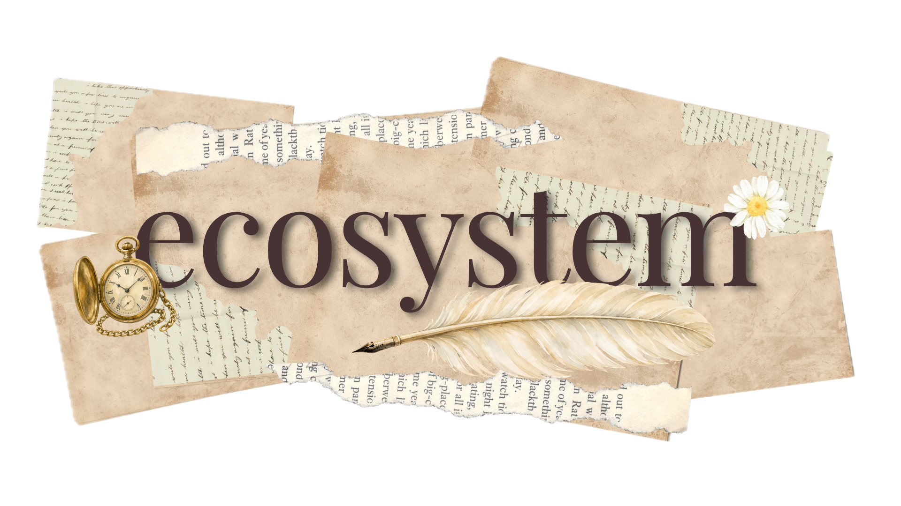

  

## Current State

This repository is the GitHub profile and personal-project index for vex. It
contains profile artwork and links to the independently maintained projects,
including the vexgraph ecosystem, `b`, and the canonical preferences Gist. It is
not the source of those projects and does not claim their features or platform
readiness. The profile content is not backed by an executable test suite.

## Scope and Limitations

This repository covers profile presentation and links only. Project behavior,
builds, release state, and platform support are owned by their respective
repositories and must be assessed there. The artwork and link targets are not
runtime or integration proof.

# hey! vex here! 🦊

### i make stuff unseriously in java and c23, and others too in my spare time

  
  
  
  
  

